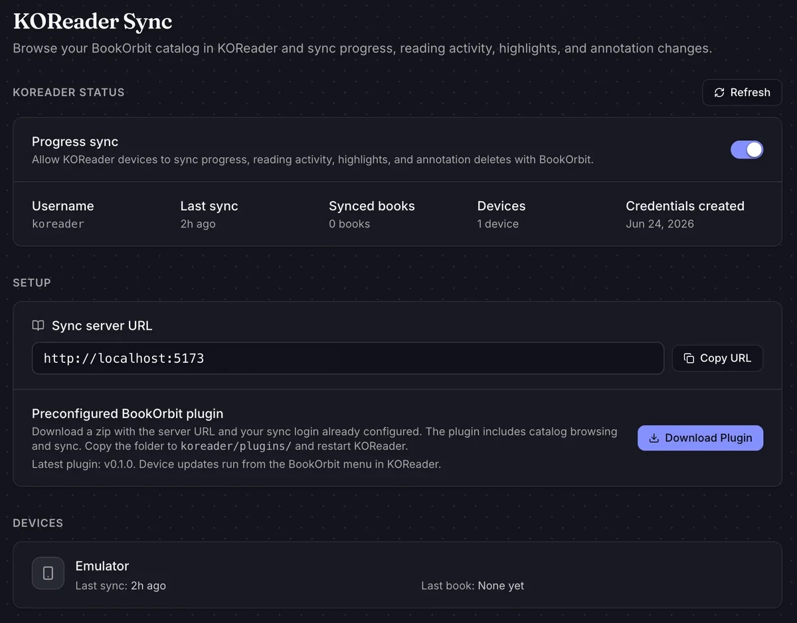

> **This is a personal fork of [CrossInk](https://github.com/uxjulia/CrossInk)** that adds [BookOrbit](https://github.com/bookorbit/bookorbit) integration — two-way sync of reading progress, highlights and bookmarks, and a catalog browser for downloading books straight from your own server — plus a working clock on hardware that has no clock chip.

Everything else — fonts, themes, reader features, reading stats, controls, the web server — comes from CrossInk unchanged, with one exception: KOReader Sync is removed to make room (see below). See the [upstream README](https://github.com/uxjulia/CrossInk#readme) for those, and the [docs](./docs/) folder in this repository for the detailed guides.

**Note**: this fork publishes releases for the Xteink X3, X4, X4 Pro and X4 Classic, the Seeed reTerminal Sticky and the BOOX Picco.

---

## What's different in this fork

- **BookOrbit progress sync** — sync your reading position with a self-hosted BookOrbit server.
- **BookOrbit highlight and bookmark sync** — two-way: what you highlight or bookmark on the device appears in the web reader at its exact place in the text, what you add on the web lands in the book, and deletions propagate both ways.
- **A BookOrbit Home theme** — Home as pages of tiles modeled on BookOrbit's dashboard: the current book, streak, week and yearly goal, the catalog's shelves with their covers, and a year of reading. Opening it never waits on the network: a sync keeps it up to date, and without an account it runs on your own numbers.
- **BookOrbit catalog browser** — browse your server's library on the device and download EPUBs over WiFi, including by author, series or collection.
- **Offline shortcuts to your own books** — "On device" and "In progress" categories that open a book directly, without touching the network.
- **Reading statistics pushed to BookOrbit** — your reading time, streaks and pace on the server's dashboard, fed by the pages you turn on the device.
- **A working clock on the X4** — the status-bar clock, which upstream can only show on hardware that has a clock chip, plus an opt-in mode that keeps the time running through sleep.
- **KOReader Sync is removed** — CrossInk v2.0.0 renamed it Sync Server and added reading-stats and clippings sync to it; its screens, settings, shortcut and sync actions (Sync Book, Sync Folder, Sync Books) are gone. The X3/X4 firmware gets a 6.5 MB partition, and this fork's BookOrbit layer plus CrossInk's own growth stopped fitting in it; dropping the second sync provider is what buys the room. Credentials already saved on the SD card are left alone: an account set up before the removal keeps the sync actions, but cannot be changed on the device.

BookOrbit exposes a KOReader-compatible sync API, so this fork talks to it the same way the official BookOrbit KOReader plugin does. Your BookOrbit server must be recent enough to serve the KOReader plugin endpoints under `{server}/api/v1/koreader` — including `plugin/catalog/*` for the catalog browser and `plugin/annotations/*` / `plugin/bookmarks/*` for highlight and bookmark sync (servers without those are detected, and the missing steps are simply skipped).

---

## The BookOrbit Home theme


Choose **BookOrbit** in **Settings → Display → UI Theme**, and Home becomes three pages of tiles modeled on BookOrbit's own dashboard:

- **Home** — the current book with its chapter, progress and time left (Confirm resumes it), your streak, this week's reading, your yearly goal, the BookOrbit tile that refreshes everything, and the other books you are reading, on this device or another one.
- **Library** — the catalog's Discover and Recently Added shelves, links to the catalog, its authors and its series, and what is on the card: how many books, how many came from BookOrbit, and how full the card is. A book that is not on the card yet downloads from its cover, and Home comes back once it is done.
- **Statistics** — a year of reading, one square a day, when you will finish the current book, the times and days you read, your all-time totals, the next badge and a highlight of the day.

Left and Right turn pages, Up and Down move between tiles; on touch devices, swipe between pages and tap a tile. Opening Home never waits on the network: Sync on Sleep or the BookOrbit tile bring the server's numbers, reading done on the device counts straight away, and without an account the theme runs on your own numbers. The [reader features guide](docs/reader-features.md#bookorbit-home) has the details.

_Screenshots taken in the simulator, with public-domain books from [Standard Ebooks](https://standardebooks.org)._

---

## Setting up your BookOrbit account

### On your BookOrbit server

The device signs in with your account's **KOReader sync credentials**, not your BookOrbit web login. Create them once, in **Settings → Devices & Sync → KOReader**, with **Create credentials** — each BookOrbit account has a single set, shared by all of its readers. Once they exist, the page's **Setup** panel shows the **Sync server URL**:



That URL is what the device asks for below. The preconfigured plugin offered on the same page is for actual KOReader devices — CrossInk needs only the URL and the credentials.

### On the device

1. Go to **Settings → System → BookOrbit Sync**.
2. Fill in **Username** and **Password** — the KOReader sync credentials created above — and **Server URL**, the Sync server URL shown on the same page. The URL accepts a bare hostname (`books.example.com`); `https://` is assumed, and a pasted `/api/v1` or `/api/v1/koreader` suffix is stripped for you.
3. Choose **Authenticate**. The device connects to WiFi and validates the credentials against your server. You should see _Successfully authenticated!_

Credentials live on the SD card in `/.crosspoint/bookorbit.json`, obfuscated with the device's hardware MAC — the same scheme CrossInk uses for KOReader credentials.

### Behind Cloudflare Access

If your server is published through a Cloudflare tunnel with an Access policy in front of it, Cloudflare stops the device's requests before they reach BookOrbit. Give the device a [service token](https://developers.cloudflare.com/cloudflare-one/access-controls/service-credentials/service-tokens/) to let it through:

1. In Cloudflare Zero Trust, create a service token and allow it on your BookOrbit application with a policy whose action is **Service Auth**.
2. On the device, start **File Transfer** and open `http://<device-ip>/settings` in a browser.
3. Under **BookOrbit Sync**, fill in **Cloudflare Access Client ID** and **Cloudflare Access Client Secret**, then save. The secret is never shown back; emptying the Client ID removes the token from the device.

The device then presents the token with every BookOrbit request, as the `CF-Access-Client-Id` and `CF-Access-Client-Secret` headers. It does so only when the server URL is `https://`.

> Give the reader a service token of its own, allowed on BookOrbit only. Its secret is kept on the SD card the way your password is — obfuscated, not encrypted — and the device does not verify the server's certificate. A token that opens nothing else can be revoked without touching the rest of your setup.

## Syncing reading progress

Open a book, then **Menu → Bookmarks tab → BookOrbit Sync**. The device compares the position stored on the server with your local one — chapter, page, percentage and the device name that last uploaded — and offers two choices:

- **Apply remote progress** — jump to the position from your other reader.
- **Upload local progress** — publish your current position to the server.

The option matching the furthest-read position is preselected. If the server has no progress for the book yet, you are offered a straight upload.

### Smart sync

**Settings → System → BookOrbit Sync → Sync Behavior** chooses what a sync does with that screen. **Ask every time**, the default, always shows it. **Smart sync** resolves the clear cases on its own and only asks when asking is genuinely useful:

- If the server is further ahead _and_ has moved since this device last synced the book, the server position is applied and you are back in the book.
- If your local position is further ahead _and_ the server has not moved since this device last synced, your position is uploaded — the screen flashes "Upload successful" and returns on its own.
- Equal positions just say "Already synced" and return.

Anything else still shows the choice screen: the first sync of a book on a device, a server that reports no dates, and above all a genuine conflict — both sides having moved since your last sync, which is exactly the case a human should arbitrate.

A newer date on the server is not enough to say it has moved, because BookOrbit's web reader saves the position a book opens at: opening the book there and closing it gives the server's position a new date without anyone having read a page. What the web reader saves is the start of its own page, so a server position found in the chapter your device last synced in, at or before the page it synced, counts as not having moved, and your further position is still uploaded. A server position further on means someone read elsewhere. One in an earlier chapter means someone went back on purpose, which is also how BookOrbit hands out a progress reset, and it is never overwritten without asking.

Each device remembers its last sync of each book (the server's date and the position both sides were left at) in a small file next to the book's cache, and every sync updates it whichever mode is active, so the history smart sync relies on is already in place when you enable it. A book last synced with v1.6.1+bookorbit.1 or earlier has the date only, and goes by it until its next sync settles the progress.

BookOrbit identifies books by the binary partial-MD5 hash of the EPUB file (the same "Binary" matching KOReader offers), so the **same EPUB file** has to be present on both readers for positions to pair up. A book downloaded from your BookOrbit catalog is the exact file your server knows about, so it matches automatically.

### Syncing without opening the menu

**Settings → Controls** lets you bind _BookOrbit Sync_ to the power button (short or long press) or to a long press on Menu or Back. The action also works outside the reader: it syncs the book you last had open, or opens the BookOrbit settings if no account is configured yet.

### Syncing when the device goes to sleep

Turn on **Settings → System → BookOrbit Sync → Sync on Sleep** and the device syncs the book you last had open every time it goes to sleep, whether from the power button, the sleep timer or a Quick Lock timeout. The sleep screen goes up first. The device then joins a saved Wi-Fi network (the last one used first, then any other saved network in range), runs a full sync behind that screen, draws the sleep screen again and finishes going to sleep. Nothing else is shown. The second refresh is there because the sleep screen loses some contrast while the sync runs behind it; a Quick Resume screen comes back in plain black and white, without the smoothed text the reader draws.

- **Waking the device cancels the sync.** Press Power the way you would to wake it. The sync stops at its next step and the device wakes as usual. Whatever the sync had already sent is kept, and the rest follows on the next sync.
- **Progress follows the Smart sync rules**, whatever **Sync Behavior** says, because nobody is there to answer the choice screen. When those rules cannot decide (the first sync of a book on this device, or both sides having moved), progress is left alone for your next manual sync. Highlights, bookmarks and reading sessions sync either way.
- **It is skipped** when no book is open, when no Wi-Fi network is saved, and when the battery is below 10% with no charger connected.

Each sync keeps Wi-Fi on for a few seconds, and longer when no saved network answers, so the option is off by default.

## Syncing highlights and bookmarks

Every BookOrbit sync of a book also exchanges its highlights and bookmarks with the
server, in both directions:

- **Highlights** made on the device appear in BookOrbit's web reader at their exact
  position in the text, with the book's exact wording; highlights created in the web
  reader come down and are drawn in the book. Deleting one on either side removes it
  from the other at the next sync.
- **Bookmarks** work the same way: a page bookmarked on the device shows up in the web
  reader, and a bookmark placed on the web lands in the book — on the right page when
  the device has already read that chapter, at the chapter start otherwise, refined the
  first time you jump to it.

Nothing to enable: if an account is configured, both ride along with every sync, and
the sync screen reports what each exchange did ("Highlights: 2 sent, 1 added, 0
removed"). Book matching is the same binary hash as progress sync, so the same EPUB
file has to be on both sides.

Details worth knowing:

- New highlights upload in batches of 8 per sync — this hardware bounds what fits
  beside an open TLS connection — so a large backlog drains over a few syncs.
- Highlights and bookmarks made before this feature existed gain their sync identity
  progressively as you read, one chapter per visit, and start syncing from there.
- A highlight's stored text is capped at 4 KB; an extremely long web highlight is drawn
  up to where that cap cuts its text.
- The device draws every highlight the same way. Notes, colors and styles added on the
  web stay on the server, and a highlight that came from the server is never sent back.
- BookOrbit 3.5.0 tracks highlights per book file rather than per device, so after the
  server is upgraded, the first syncs of each book receive back every highlight it
  already had, 8 per sync. They are recognized and nothing is duplicated.
- With BookOrbit 3.5.0 or later, a book that lost all its highlights or bookmarks on the
  device (a wiped card, say) gets them back from the server at its next sync.

## Reading statistics

Every BookOrbit sync of a book also uploads the reading it has recorded since the last
one: one event per page you read, with when you started it and how long you stayed on it.
That is what the official BookOrbit KOReader plugin sends too, so the server's reading
time, streaks, pace and reading-DNA views fill in the same way. It is one-way — BookOrbit
has no API to read stats back — so the device's own Reading Stats screens are unaffected
and keep working offline.

Nothing to enable: if an account is configured, the events ride along with each sync. They
are queued per book on the SD card in the meantime, so nothing is lost if you read offline
for a week.

### How faithful the timestamps are

**On the X3 this section does not apply**: it has a clock chip, so every page event is
stamped with the real time and lands exactly where it belongs.

The X4 has no clock chip. Its clock stops whenever the device sleeps, and the firmware can
only put it back to the last time it knew about at wake — so a page read at 20:00 can be
recorded as if it happened at 08:20. Rather than upload that, the device records which
_clock timeline_ each event belongs to and fixes the timestamps at upload time, using the
error each sync measures against NTP. Two cases:

- **With Settings → System → Device → Keep Clock While Asleep on**, the clock never stops,
  so the only error is the oscillator's drift — a couple of minutes per 12 h. Each sync
  measures that drift and spreads it across the events in proportion to when they
  happened, so sessions land within seconds of reality. Nothing to think about. Note that
  the drift is only corrected in the _uploaded stats_: the clock **shown** on screen stays
  a minute or two off until the next WiFi connection resets it.
- **With the option off**, accuracy depends on you syncing at least once per run — a run
  being everything between two sleeps. A sync anchors the run's whole timeline, so every
  session it uploads is placed correctly, including the ones read before it in that run.

The friction points of leaving the option off:

- **A run with no sync in it keeps a wrong timestamp for good.** Its sessions are dated
  from the last time the device knew, which is where the _previous_ run ended — so they
  pile up right after it. Read in the morning, sleep, read in the evening and sync only
  then, and the morning session is the one that lands wrong, possibly on the previous day.
  That is a real cost on the server side: BookOrbit's streaks and daily charts key off the
  date, so a misdated session breaks a streak that you did not actually break.
- **The order and the pacing are always right, only the anchor moves.** Gaps between pages
  within a run are measured by a timer that keeps running, so a shifted block stays
  internally exact — a session never appears to last longer or shorter than it did.
- **It gets worse with each sleep, not with time.** Three runs without a sync means three
  blocks stacked onto the same anchor, not a gradual smear.
- **The cheap mitigation is a button.** Bind _BookOrbit Sync_ to the power button under
  **Settings → Controls** and press it when you put the book down; one sync per run is all
  the accuracy needs. It is also what drains the queue, so it costs nothing extra.
  **Sync on Sleep** does the same every time the device sleeps, with no button to press.
- **A flat battery or a firmware flash loses the clock entirely.** The sessions queued
  before that still upload correctly as long as a sync happens in the same run, because
  they are placed relative to that sync rather than by absolute time.

## Browsing and downloading from the catalog

Reach the catalog from **Settings → System → BookOrbit Sync → Browse Catalog**, or from the **BookOrbit** entry in the home menu (it appears once an account is configured).

The root list contains:

| Entry                                         | What it shows                                                                                                                                       |
| --------------------------------------------- | --------------------------------------------------------------------------------------------------------------------------------------------------- |
| Recently added / Continue reading / All books | Your server's own sections                                                                                                                          |
| **Authors** / **Series**                      | Paged lists with a book count per entry; pick one to see its books (series are listed in series order)                                              |
| **Collections**                               | Your server's collections, with a book count per entry; pick one to see its books                                                                   |
| **Want to Read**                              | The books you most recently marked as want to read, when your server offers that shelf                                                             |
| **Search**                                    | Free-text search of your library                                                                                                                    |
| **On device**                                 | Everything downloaded from the catalog, wherever it was filed, plus every EPUB in the download folder, the SD card root and `/Read` — works offline |
| **In progress**                               | Recent books you haven't finished yet — works offline                                                                                               |

In a server book list, **Confirm** downloads the book into the download folder configured in the BookOrbit settings (the SD card root by default). A download that gets interrupted resumes automatically on retry, and **Back** cancels it. Books already present on the device are marked with a dot at the end of the line, so you can tell at a glance what is worth downloading.

The file is named by **your server's KOReader file naming template** — BookOrbit's _Settings → Koreader → File Naming_, the same template its own KOReader plugin follows — so a book can land inside a series folder, for instance. BookOrbit resolves the template and tells the device where the file belongs; a per-device override set on the server is honoured too, and any folder it asks for is created under your download folder. If your account has no template, BookOrbit's default applies, which files books under `Series/` and `Standalone/`. Books downloaded before this behaviur existed are left where they are.

A server book list (a root section, the books of an author, series, collection, library or SmartScope, or search results) can be sorted and filtered, as the Library is sorted:

- **Sort** — date added, title, author (by last name), recently read or series. The first row of the picker flips the direction (A-Z or Z-A); a newly picked order starts in its natural direction, newest first for dates.
- **Filter** — all books, or only those that are unread, being read or finished on your BookOrbit account. The header then names the filter, and its count is the number of matching books.

On the X3 and X4, **Left** opens Sort and **Right** opens Filter while **Up** and **Down** move through the list, as in the Library. On touch devices, the two buttons at the right of the header open them. Your server does the sorting and filtering, so a long list keeps paging exactly. The choice applies to the list you are in; opening a section again shows it in its own order.

When the Library's **List View** is **Expanded**, a book list is split into sections the way the Library splits its own: by first letter when sorted by title or author (where your server ranks it, by the author's last name), by day when sorted by date added, and by series when sorted by series. The second row of the Sort picker switches the List View between Expanded and Compact without leaving the catalog; it is the Library's setting, so the Library follows.

**Want to Read** lists the books you most recently marked as want to read in BookOrbit: the shelf BookOrbit's own KOReader plugin shows, a dozen books at most, in the order you marked them. It appears after the server's sections when your server offers that shelf. BookOrbit's catalog cannot filter a whole list by that status, so it is a shelf rather than a filter choice.

In **On device** and **In progress**, Confirm opens the book in the reader instead of downloading it.

On the X3 and X4, the reader restarts briefly before it opens the catalog and before each download, so the secure connection gets the memory it needs; leaving the catalog restarts it once more. A long listing keeps only the pages around the one on screen in memory and reloads the others from the SD card as you scroll back.

> If the catalog reports _"BookOrbit sent an unexpected reply"_, the server answered but not with the catalog API — usually a BookOrbit version without the KOReader catalog endpoints, a wrong server URL, or a reverse proxy/SSO layer intercepting `/api/v1/koreader/plugin/*`.

---

## Clock on devices without a clock chip

The X4 has no battery-backed RTC, so upstream's status-bar clock never appeared on it and
its settings were hidden. Here the clock reads the device's system clock instead, which is
refreshed from NTP on every WiFi connection.

To turn it on, open **Settings → Display → Status Bar** and put `Clock` in the left, center
or right position; to see it while reading, add it to a reader bar under **Settings →
Reader → Status Bars**. `Date` works the same way. Then set **Settings → System → Device →
Clock UTC Offset** and **Clock Format**. The time appears once the device has been connected
to WiFi at least once — before that there is nothing to display. A clock you had turned on
with the former **Hide Clock** setting is carried over.

### Keeping the time through sleep, and what it costs

By default the device releases its own power latch when it sleeps, which cuts power to
everything including the timer that counts wall-clock time. The time is therefore lost at
every sleep and only comes back at the next WiFi connection. **Settings → System → Device
→ Keep Clock While Asleep** skips that release, so the board stays powered, the processor
enters a genuine deep sleep, and the clock keeps running.

It is off by default because it trades standby battery life for an almost always-correct clock (time will drift when device is not connected to WiFi for a long time).
Before leaving it on, know that:

- **the device no longer powers off completely when it sleeps.** It keeps drawing a small
  current, so it will slowly discharge in a drawer instead of sitting indefinitely.
- **the cost has only been spot-checked.** On an X4, twelve hours of sleep with the setting
  enabled cost about 5% of battery, which extrapolates to roughly ten days of standby.
  Over the same twelve hours the clock drifted two to three minutes, since it runs on an
  internal RC oscillator rather than a crystal; the next WiFi connection resets it. Treat
  both as one measurement rather than a specification, and watch your own battery over a
  few days before relying on it.

Turning the setting back off restores the stock behaviour exactly.

It also decides how faithful your uploaded reading-session timestamps are — see
[Reading statistics](#reading-statistics), which is the main reason to leave it on.

---

## Installation

Download the `firmware-*.bin` for your device from **this repository's** [releases page](https://github.com/agosez/CrossInk-Bookorbit/releases) — not upstream's, which does not include BookOrbit support. CrossInk's own web installer only offers upstream builds, so flash the file as a custom firmware with the [CrossPoint flash tools](https://crosspointreader.com/#flash-tools), from the command line, or from the SD card — [Installation](./docs/installation.md) walks through each path, including USB-locked devices and reverting to upstream CrossInk.

Once this firmware is installed, **Settings → System → Check for Updates** resolves against this fork's releases, so later versions arrive over the air. Devices running upstream CrossInk will not see these releases: the first install has to be done by USB or SD card. Picco is the exception: it has no over-the-air or SD card update, so every version goes through the USB steps in [Installation](./docs/installation.md#boox-picco), which keep its factory recovery software.

### Languages

Since CrossInk v2.0.0 only English is built into the firmware. This fork publishes its own language packs, translated in full including the BookOrbit screens: choose **Settings → System → Device → Download Languages**, connect to Wi-Fi and pick a language, and the reader installs it and restarts to Home. After updating from an earlier version, What's New offers to download the language you were using. Without Wi-Fi, take `crossink-languages-<version>.zip` from the same release as the firmware, copy its `.crossink` folder to the root of the SD card, then pick the language in **Settings → System → Device → Language**. Upstream's packs do not fit this fork: they lack its screens.

## Development

```sh
pio run -e default --target upload   # X3/X4 build, flashed over USB-C; see platformio.ini for the other devices
```

See [Getting Started](./docs/development/getting-started.md) for prerequisites and validation commands, and [Testing and Debugging](./docs/development/testing-debugging.md) for serial logging and static analysis. `AGENTS.md` holds the repository's engineering conventions.

## Documentation

- [User Guide](./docs/user-guide.md) and [Reader Features](./docs/reader-features.md)
- [Controls](./docs/controls.md) — full button action list
- [Installation](./docs/installation.md)
- [Data Cache](./docs/data-cache.md) and [File Formats](./docs/file-formats.md)
- [Common issues](./docs/troubleshooting.md)
