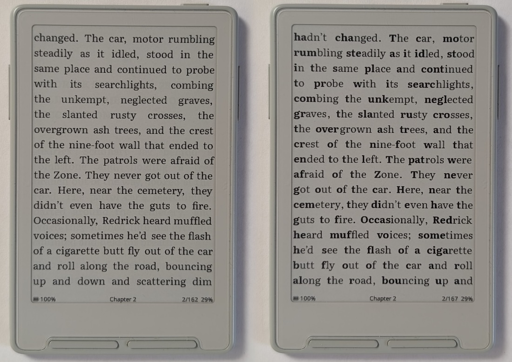
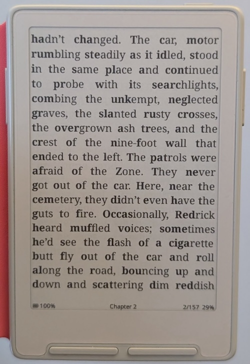
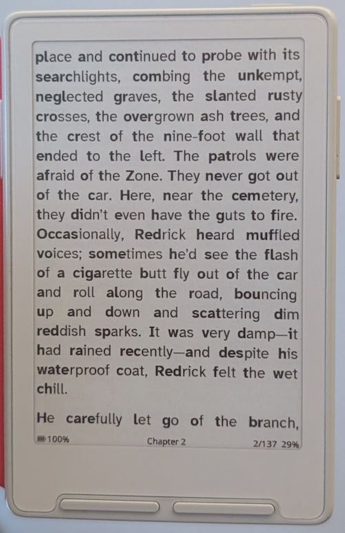

# Reader Features

This page covers a subset of CrossInk reader features that go beyond basic page turning. It is not a complete list of every reader setting or action. For a more complete list of features as they were released, see the [releases page](https://github.com/uxjulia/CrossInk/releases).

The sections here focus on larger CrossInk-specific reader features. Small fixes, implementation details, and features that only arrived from upstream CrossPoint are intentionally left out.

## In-book Reader Options

Reader settings are available directly from the in-book menu without leaving the book.

EPUB books use five icon tabs on every device. Use **Font** and **Layout**
to adjust settings such as:

- Font family
- Font size
- Line spacing
- Word spacing (EPUB)
- Margins
- Alignment
- Image rendering
- [Publisher Page Numbers](#publisher-page-numbers)
- [Focus Reading](#focus-reading) / Guide Dots

Changes take effect immediately, with live previews for font, spacing, and
margin choices. The **More**, **Bookmarks**, and **Settings** tabs contain
navigation, reading tools, and book settings. See the [Reader Menu](./user-guide.md#5-reader-menu)
for the tab map and button controls.

EPUB layout choices such as font size and margins can be saved for that book
and take precedence over matching global defaults. Status bar settings are global. See [Global settings and individual
books](./user-guide.md#362-reader) for how to restore a book's layout choices
to the global defaults.

For books that are slow to index or fail because of complex publisher styling,
see [EPUB Indexing Methods](./epub-indexing.md) and
[EPUB Render Modes](./epub-render-modes.md).

## Focus Reading

Focus Reading is a reading aid that bolds the first portion of each word,
guiding your eyes to natural fixation points and helping you read faster with
less effort. Some readers, particularly those with ADHD, find it helps them
stay engaged with the text and reduces mind-wandering.

### Enabling Focus Reading

1. Open **Settings > Reader**.
2. Toggle **Focus Reading** on.

Toggling the setting triggers a re-index of the current book, just like changing
font settings. Once indexing is complete, page turns proceed as normal. No
changes are made to the EPUB file.

### Examples

_Left: Focus Reading off. Right: Focus Reading on. Both using Literata._

_Focus Reading with Noto Serif font._

_Focus Reading with Merriweather font._

_Focus Reading with Atkinson Hyperlegible Next font._

### Notes

Focus Reading only applies to regular body text. Already-bold text, including
headings and emphasis, is left unchanged.

## Font Sizes And Downloadable Font Ranges

CrossInk adds a wider range of reader font-sizes, including smaller and larger point sizes for users who want denser pages or much larger text.

The reader can also use SD-card font packs with selectable font-size ranges. This lets you keep the installed firmware smaller while still using extra sizes or custom fonts from the SD card.

Related docs:

- [SD Card Fonts](./sd-card-fonts.md)

## Custom TTF Fonts

On ESP32-S3 readers, you can use your own static TrueType (`.ttf`) fonts. Copy
the files into `/fonts` on the SD card, either together or in a folder named
after the font family. Restart the reader or refresh its font list, then choose
the family from the font picker.

For the full range of text styles, include all four faces: regular, bold,
italic, and bold italic. A family with fewer faces can still be used, but some
styles will fall back to another face. Variable fonts are not supported.

See [Scalable Fonts](./scalable-fonts.md) for installation details and limits.

## Reader Status Bars

Customize top and bottom status bars separately from **Settings > Reader >
Status Bars**, or from the EPUB Reader Menu's **Settings > Status Bars**.
Each bar has three left slots, one center slot, and three right slots. Choose
items such as titles, page counts, progress, battery, or Time Left, and configure
a book/chapter progress bar. The editor previews each bar where it appears
while reading. These settings are global and apply across EPUB, TXT, and XTC
books; the available information varies by format.

## Dark Reader Mode

Dark Mode reverses the display colors so text is shown light-on-dark in the
reader and menus. Toggle it from **Settings > Display > Dark Mode**.

Dark Reader Mode can also be assigned to shortcut actions, so it can be switched without opening the full settings menu.

## Line Spacing

CrossInk supports adjustable reader line spacing from compact to wide spacing.

Use this when a book feels visually cramped, or when larger fonts need more vertical room to stay comfortable.

## Word Spacing

EPUB readers can choose from five word-spacing levels: **Normal** and levels
**1** through **4**. Higher levels add more space between words, which can make
text easier to scan without changing the font size or line height.

Open the reader menu, then select **Font > Line/Word Spacing > Word Spacing**. The current EPUB is laid out again when you change this
setting, so the number and positions of pages may change. Word Spacing is not available for
TXT books.

## Publisher Page Numbers

Publisher Page Numbers show page labels supplied by the EPUB, such as the
printed page numbers from a physical edition. When the book includes labeled
page-break markers, CrossInk displays those labels in the reader margin beside
the matching content.

To enable them, open the reader menu and select **Layout > Publisher Page
Numbers**. If an EPUB does not contain labeled page-break markers, there
are no publisher page numbers for CrossInk to display.

Publisher page markers are preserved by **CrossInk Default** and **Balanced**
render modes. **Light** and **Safe Mode** omit them when simplifying a difficult
book's layout.

## Stable Page Numbers

Stable Page Numbers show a consistent reference page number in the reader's
status bar, such as `120/540`. They are calculated from fixed reference-page
metadata in the EPUB instead of the current screen layout, so they remain
consistent when you change fonts, spacing, orientation, or indexing mode.

To enable them:

1. Open the reader menu and select the **Settings** tab.
2. Select **Status Bars**.
3. Select **Top Status Bar** or **Bottom Status Bar**.
4. Choose a left, center, or right slot, then select **Stable Page Numbers**.

The item shows a page number only when the current EPUB contains valid CrossInk
reference metadata. To create that metadata, optimize the EPUB in the CrossInk web
interface or with [Inky](https://inky.crossink.dev) before uploading it to the reader.
In the optimizer's settings, the **Characters per Page** controls the reference-page size; the default
is 1,500 characters. Lower values create more reference pages, while higher
values create fewer.

Stable Page Numbers are not publisher or printed-edition page numbers. Use
[Publisher Page Numbers](#publisher-page-numbers) when you want the page labels
provided by the book itself.

## Guide Dots

Guide Dots adds small dots between words. The idea comes from speed-reading guidance where focusing on the space between words can help peripheral vision pick up more of the surrounding text.

Toggle it from **Reader settings**.

## Force Paragraph Indents

Some books do not define paragraph indents in a way the firmware understands, which can make the page look like one large wall of text.

Force Paragraph Indents adds an indent at each new paragraph regardless of how the book is formatted.

This works when **Reader Paragraph Alignment** is set to:

- Left
- Justify
- Book's Style

Toggle it from **Reader settings**.

## Auto Page Turn

Auto Page Turn can advance pages on a timer while reading.

CrossInk adds a custom interval picker, so the interval is not limited to the built-in presets. The reader can also remember a different Auto Page Turn interval per book.

Open the reader menu's **More** tab and select **Auto Page Turn** to configure it.

## Time Left

CrossInk can show estimated time left in the current chapter or book.

The estimate is based on your recent forward-page reading pace. Non-linear jumps such as chapter skips, bookmark jumps, and footnote navigation are handled separately so they do not immediately distort the normal reading estimate.

Use **Reset Reading Pace** in the EPUB Reader Menu's **Settings** tab if the estimate was trained by unusual reading behavior and you want it to learn again from fresh page turns.

## Bookmarks

CrossInk supports EPUB bookmarks from the reader.

You can:

- Add a bookmark while reading
- See bookmark indicators in the reader
- Open a bookmark list
- Jump back to saved locations
- Delete individual bookmarks

## Clippings And Highlights

CrossInk supports EPUB text clippings from the reader. Use **Create Clipping**
from the reader menu or a configured shortcut, select text, and save it.

On button devices, move the cursor with the direction buttons, press **Select**
at the first word, move to the last word, then press **Done**. On touchscreen
devices, a tap saves the single word you touch. To save a range, touch and hold
the first word until range selection begins, drag to the last word, then lift
your finger; CrossInk saves the clipping immediately. A touch drag does not
turn pages, so use the direction buttons if a clipping must extend to another
page.

A saved clipping is used in three ways:

- It appears as a highlight in the reader
- It appears in the in-app clipping list for that book
- It is appended to `/My Clippings.txt` on the SD card in a Kindle-style text format

The in-app clipping list is stored separately from the text export. Deleting a
clipping from CrossInk removes the saved clipping and highlight from the device
UI, but it does not rewrite old entries that were already appended to
`/My Clippings.txt`.

Open **Clippings** from the reader menu's bookmarks tab after saving a
clipping. On touchscreen devices, tap a clipping to read its full text, swipe
up or down to move through a long clipping, and tap **Open** to return to its
location in the book. Touch and hold a clipping in the list, or its text in
the detail view, to open the delete action. Deleting removes the in-app
clipping and its highlight, not an entry already exported to
`/My Clippings.txt`.

## Reading Stats

CrossInk tracks per-book reading stats automatically and aggregates them into
global stats for EPUB and XTC files. With tracking enabled for the device and
book, you can view that book's **Reading Stats** directly from its **Library**
or **Browse Files** action menu without opening it first.

### Turn tracking on or off

The device-wide switch is in **Settings > System > Reading Stats > Track Reading Stats**. When it is off, CrossInk stops recording new per-book and all-time stats. It does not delete saved stats or saved Time Left pace estimates. Turning tracking back on makes the saved history available again and resumes recording for books whose own tracking is enabled. Reading time and pages from the period when tracking was off are not added later.

While device-wide tracking is off, recorded-stat actions and displays are hidden from the menus and home themes that normally show them. The Dashboard can still show a saved Time Left estimate when one is available. The **Reading Stats** and **Minimal Stats** sleep screens fall back to the regular Minimal sleep screen when tracking is off device-wide or for the recent book. The tracking switch remains available in Settings so it can be turned back on.

You can also pause stats for one EPUB or XTC book while device-wide tracking is on. For an EPUB, use **Track Reading Stats** in the Reader Menu's **Settings** tab; for an XTC book, use **Track Reading Stats** in its Reader Menu. You can also use the book's Library/File Browser action menu when available. This preserves the book's saved stats and stops adding stats for that book, including its contribution to all-time totals. While paused, that book's **Reading Stats** view and book-specific theme display are hidden; its saved Time Left estimate may still appear in the Dashboard. Re-enable tracking to show the saved book history and resume recording.

Tracked stats include:

- Total reading time
- Number of sessions
- Pages turned
- Average session time
- All-time reading stats, including total books read

Recent CrossInk versions expanded this into a larger stats system, including synced totals, richer X3 stats screens, reading-streak and time charts, editable stat dates, idle-time filtering, reset controls, and all-time stats backup options.

**Note**: Date-related stats require a device with a real-time clock (RTC) module. The X4 does not have an RTC module, therefore will not have as detailed stats as the X3.

Reading stats can also be used as a sleep screen, including the Minimal Stats sleep screen on supported builds.

For two-device syncing, see [Reading Stats Sync](./reading-stats-sync.md).

## Nearby Position Sync

CrossInk can copy the current EPUB position from one nearby CrossInk reader to
another over ESP-NOW. Open the same EPUB on both readers, choose **Nearby
Position Sync** from the in-book menu on both devices, and press **Share** on
the reader that is already at the correct page.

The receiving reader shows the incoming position and only applies it after you
confirm it.

For details and troubleshooting, see [Nearby Position Sync](./nearby-position-sync.md).

## Finished Books And Read Folder

You can manually mark a book as finished from the in-book menu.

At 99% book progress, CrossInk also shows a popup asking whether to mark the book as finished.

If **Move finished books to Read folder** is enabled, books marked as finished are moved to `/Read/` on the SD card.

Marking books as finished also contributes to the total **Books Read** reading stat.

The file browser can also mark books as finished without opening them first.

## Reader Controls And Shortcuts

CrossInk adds reader-focused control options beyond the default button mappings.

Examples include:

- Reader-only front-button actions
- Front and side button mappings that respect the current orientation
- X3 tilt shortcuts
- Power-button reader shortcut actions
- Quick access to Controls from the in-reader menu
- Side-button shortcuts for changing font size or font family

For the full controls reference, see [Controls](./controls.md).

## BookOrbit Home

The **BookOrbit** theme (**Settings > Display > UI Theme**) replaces the Home screen with pages of tiles. Clock, date and battery stay in the status bar, which you configure as usual.

- **Home**: the current book, your reading streak, the week's reading, your yearly goal, and the other books you are reading.
- **Library** (with a BookOrbit account): the Discover and Recently Added shelves, links into the catalog, and an **On card** tile: the books in the Library (as of its last scan), how many of them came from the catalog, and how full the card is, as a bar with the used and total space beside it. Selecting a book opens it if it is on the card; otherwise it is downloaded, and Home comes back once the download is done or cancelled.
- **Statistics**: a year of reading, one square a day with its pattern showing how long you read, then a finish forecast for the current book, when you read and your all-time totals. The page is hidden while **Track Reading Stats** is off.

On button devices, **Left** and **Right** turn pages, **Up** and **Down** move between the tiles of the page, **Confirm** opens the selected tile (the current book first, so one press resumes reading), and **Back** opens the menu with everything else, Settings included. On touch devices, tap a tile, swipe left or right to change page, swipe up for the menu and down for Settings.

Opening Home never uses the network. With a BookOrbit account, the goal, the badge, the highlight of the day, the shelves and reading from your other devices are refreshed by **Sync on Sleep**, or by selecting the BookOrbit tile. That tile shows how old the data is, and a message tells you what the refresh is doing while it runs. Reading on the device counts on Home straight away, books you finish included in the goal; once a sync has sent that reading to BookOrbit, the next refresh shows the server's own numbers. Without an account, every tile that needs one gives way to your own numbers.

Reading time per day needs a date, so on the X4, which has no clock chip, it starts counting once the device has set its clock over Wi-Fi.

